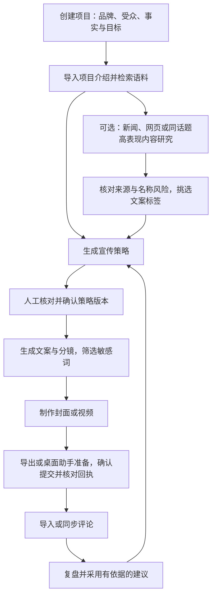

# Shengzhang Studio 自媒体运营工作站 · v2.2.0

在总控一个页面提出需求、核对计划、批准各 Agent 派工、查看文案与配图。每次派工都可修改指令、显式选择本次 Skills 或默认规则，并单独确认费用。前置任务完成后会准备下一项，仍等待用户批准。

[Windows x64 下载](https://github.com/JerryCoal/shengzhang-studio/releases/download/v2.2.0/Shengzhang-Studio-2.2.0-windows-x64.zip) · [SHA-256 校验](https://github.com/JerryCoal/shengzhang-studio/releases/download/v2.2.0/Shengzhang-Studio-2.2.0-windows-x64.zip.sha256) · [v2.2.0 发布页](https://github.com/JerryCoal/shengzhang-studio/releases/tag/v2.2.0)

[升级说明](docs/UPGRADE-2.2.0.md) · [本轮改动](docs/RELEASE-2.2.0.md) · [验证范围](docs/VALIDATION-2.2.0.md) · [开发交接](docs/DEVELOPMENT-HANDOFF-2.2.0.md) · [本地 Qwen 接口](docs/LOCAL-QWEN-SETUP.md)

- 文案和脚本可在原页面接续一至四张图片；各张单独保存、采用和重做，失败项不会带着已完成图片重复生成。
- 派工和图片设置自动保存；刷新恢复草稿，执行仍须重新核对批准。
- 自装 Skills 可修改；已完成、失败及取消任务可移除，成果和费用记录保留。
- 旧任务链接仍定位到对应项目、任务、运行和成果版本；历史创作与发布入口保留。

本版沿用 v2.1.0 的预发行标记，提供 Windows 个人版与源码，不包含新版团队部署压缩包。完整回归 1303 项通过、2 项跳过，最终界面检查、Windows 隔离启动和压缩包校验通过。文案和图片使用模拟服务验收，未调用真实收费生成或平台发布；详细范围见验证记录。

解压完整 Windows 包后启动 ShengzhangStudio.exe。源码工作区 Start-App.cmd 按项目版本选择对应包。既有本地项目、账号和素材继续保留；升级前退出旧版并备份，避免新旧程序同时写入数据库。

JCoal 开发。从灵感、平台创作、确认发布，到结果分析与经验复用，在同一工作站完成账号矩阵运营。

v2.0.0 基于已有架构增量升级：独立灵感/小红书/抖音/Instagram/YouTube/结果分析 Agent 页面；显式经验优先、多个适用 Skills、逐 Agent 模型选择；GLM 官方接入；统一并发任务中心与加密恢复；跨平台改编交接、发布确认及飞书记录询问。新用户图片默认官方 Seedream，视频沿用 Seedance，历史配置保持不变。

[v2.0.0 发布页](https://github.com/JerryCoal/shengzhang-studio/releases/tag/v2.0.0) · [使用与升级](docs/UPGRADE-2.0.0.md) · [验证范围](docs/VALIDATION-2.0.0.md) · [开发交接](docs/DEVELOPMENT-HANDOFF-2.0.0.md) · [GLM 设置](docs/GLM-SETUP.md)

- [Windows 个人版](https://github.com/JerryCoal/shengzhang-studio/releases/download/v2.0.0/Shengzhang-Studio-2.0.0-windows-x64.zip)
- [Windows 团队部署包](https://github.com/JerryCoal/shengzhang-studio/releases/download/v2.0.0/Shengzhang-Studio-Team-2.0.0-windows-x64.zip)

真实生成、平台采集和投稿需要对应服务的可用凭证/权限与用户确认。检查点暂停不等于撤销已提交的服务商请求。Windows/团队版提供完整 Agent 工作流；独立中转网页保留草稿，但暂不传送私人 Agent 数据包。发布包不含任何工作区数据、账号会话或密钥。

## 历史迭代记录

以下说明保留各版本当时状态，不代表当前发布状态。当前功能与测试边界以 v2.2.0 及其验证记录为准。

### v1.26.0 · Redfox 本地测试版

新增 Redfox 三路开关：平台资料读取、图片与视频生成、联网搜索。默认图片使用 Redfox Seedream 5.0 Pro，视频使用 Redfox Seedance 2.0，文字策略和文案仍沿用现有模型。已接入五平台作品研究与公开指标、四平台评论、聚合热榜；具体范围和待实账号验证的限制见 [改动报告](docs/REDFOX-TEST-REPORT-1.26.0.md)、[使用说明](docs/UPGRADE-1.26.0.md)、[验证记录](docs/VALIDATION-1.26.0.md)。本次仅本地测试交付，未发布到公网。

## v1.25.0 本地团队版

新增浏览器多人访问同一台主机的团队模式：Caddy HTTPS 入口、Node 后端、共享加密工作区、员工账号与权限、按成员隔离的创作选择和操作记录。个人版与原有数据目录保留。见 [团队部署](docs/TEAM-DEPLOYMENT-1.25.0.md)、[使用说明](docs/UPGRADE-1.25.0.md)、[发布记录](docs/RELEASE-1.25.0.md)、[开发交接](docs/DEVELOPMENT-HANDOFF-1.25.0.md) 和 [验证记录](docs/VALIDATION-1.25.0.md)。本次仅本地交付，不自动开放公网。

## v1.24.0 累计更新

新增账号身份记忆（MD/TXT）与多套创作方案，选定账号后每次 AI 创作携带身份与对应 Skills；图文和视频支持选择电脑文件或拖拽，已有成品可预览后采用。“前往发布”可进入核对，未就绪时显示具体原因。详见 [使用说明](docs/UPGRADE-1.24.0.md)、[更新记录](docs/RELEASE-1.24.0.md)、[开发交接](docs/DEVELOPMENT-HANDOFF-1.24.0.md) 和 [验证记录](docs/VALIDATION-1.24.0.md)。本次仅本地交付。

## v1.23.0 累计更新

新增“养号 · 日常图文”目的：填写发布主题、主要场景和自定义文案 Prompt，可上传场景参考图片；创建后直接进入图文制作，支持 AI 文案、Seedream 配图、免费本地排版、导出与选择账号发布。详见 [使用说明](docs/UPGRADE-1.23.0.md)、[更新记录](docs/RELEASE-1.23.0.md)、[开发交接](docs/DEVELOPMENT-HANDOFF-1.23.0.md) 和 [验证记录](docs/VALIDATION-1.23.0.md)。本次仅本地交付。

## v1.22.0 累计更新

采用飞书式的清爽协作布局：蓝白界面、分组导航、平台账号快捷入口和紧凑工作台。设置中的 9 类功能改为分组目录，窄屏使用下拉选择；API 配置与 Skills 列表根据内容宽度排版。保留现有账号、生成、发布与采集流程，无数据迁移。

见 [使用说明](docs/UPGRADE-1.22.0.md)、[更新内容](docs/RELEASE-1.22.0.md)、[开发交接](docs/DEVELOPMENT-HANDOFF-1.22.0.md) 和 [验证记录](docs/VALIDATION-1.22.0.md)。这是本地升级，未上传 GitHub；下方公开下载仍为 v1.19.0。

## v1.21.0 累计更新

Skills 统一在“连接与设置 → AI Skills”管理。20 个 AI 工作步骤各有默认规则和自装规则下拉列表；导入时先指定适用步骤，生成时自动读取该步骤设置。任务保留启动时的规则快照，按工作站用户隔离保存。累计包含 v1.20.0 的介绍文档自动填写项目概要，以及 v1.19.1 的小红书话题传参修复。

见 [v1.21.0 使用说明](docs/UPGRADE-1.21.0.md)、[开发交接](docs/DEVELOPMENT-HANDOFF-1.21.0.md)、[验证记录](docs/VALIDATION-1.21.0.md) 和 [全流程 Skills](docs/AI-SKILLS-WORKFLOW.md)。

# 生长 STUDIO v1.19.0 测试版

新增 TikTok、YouTube、Instagram MCP 接口与抖音独立采集连接，项目渠道、导出、发布记录与评论归属支持五个平台。按服务真实工具展示能力；海外账号需要官方授权。热点研究改为「同话题内容 → 核对播放/互动口径 → 清洗、去重与相关性筛选 → 有证据的创作假设与实验」。界面换成灰白底、深灰文字和少量蓝色操作，保留字号与重点加重。

本版以 [GitHub Pre-release](https://github.com/JerryCoal/shengzhang-studio/releases/tag/v1.19.0) 提供，累计包含 v1.18.0 的文档增强、自然表达与小红书多账号升级。见 [使用说明](docs/UPGRADE-1.19.0.md)、[MCP 接入指南](docs/MATRIX-MCP-SETUP.md) 和 [开发交接](docs/DEVELOPMENT-HANDOFF-1.19.0.md)。**TikTok 当前兼容服务没有评论读取与全站搜索，新平台真实授权投稿仍需联调，工具连接成功不代表已经获批发布权限。**

## v1.18.0 累计更新

新增文档资料卡、自然表达润色，以及外部小红书 MCP 多账号与启动信息保存。资料卡经用户核对采纳后用于新策略；普通文案在同一次生成中润色，保留敏感词和用户 Skills。复杂文档可选装本机 Docling。多个平台账号分别管理登录目录、端口和连接，重开应用后可点击重启已保存的服务。见 [v1.18.0 使用说明](docs/UPGRADE-1.18.0.md) 和 [增量交接](docs/DEVELOPMENT-HANDOFF-1.18.0.md)。**v1.18.0 原为本地迭代，现累计进入 v1.19.0，不另建独立 Release；旧文档中的“未上传”描述当时状态。**

## 保留的历史版本 v1.17.0

本次新增 Seedream 可见水印设置和生成后的本机角标检查。封面与视频首尾帧可以分别选择本次是否添加可见水印，生成后展示检查结果并放大人工核对。沿用已有密钥，无新增收费识别服务。详见 [v1.17.0 使用说明](docs/UPGRADE-1.17.0.md)。本版以 GitHub Pre-release 提供，累计包含 v1.7.0 之后的升级。接手开发请阅读 [开发交接文档](docs/DEVELOPMENT-HANDOFF-1.17.0.md)。

# 生长 STUDIO · AI 运营工作台

**从一个想法，到持续生长的品牌。**

后续开发以**账号矩阵运营**为主要方向：围绕多个账号的定位、差异化创作、排期、发布及数据复盘逐步完善。具体原则见 [项目开发约定](AGENTS.md)；这是迭代方向，不代表所有矩阵能力已经上线。

**v1.11.0 起加入近期内容研究（2026-10-14）。** 原始流程为：AI 规划检索词 → 小红书 MCP / 搜索服务 / 中文新闻源 → 近七天清洗 → 本地关键词或可选 Qwen RAG → 有原文证据的分析 → 用户选用标签 → 策略与文案创作。共 14 份内置 Skills，普通文案继续支持用户安装的规则。研究库和密钥按本地用户加密保存，付费请求逐轮确认、分开记账。[历史更新](docs/RELEASE-1.11.0.md) · [最新研究流程](docs/RECENT-CONTENT-RESEARCH.md) · [Qwen RAG](docs/QWEN-RAG.md) · [全流程 Skills](docs/AI-SKILLS-WORKFLOW.md)。本地旧版安装包继续保留。

v1.7.1 已验证小红书 MCP 真实连接、扫码登录和 11 条自有作品评论导入；重复导入不增加条数，真实最终发布尚未测试。[验证记录](docs/PLATFORM-ASSIST-VALIDATION-1.7.1.md)

**历史测试版：v1.6.0 · Windows x64。** 累计包含 v1.3.x–v1.6.0 的升级：可维护敏感词与 AI 语义检查、飞书发布计划、评论采集和分析、运营数据空间，以及用户确认后提交的官方页面发布助手。详见 [更新记录](docs/RELEASE-1.6.0.md) 与 [使用说明](docs/UPGRADE-1.6.0.md)。

生长 STUDIO 将品牌资料、项目语料、热点筛选、宣传策略、文案与封面、视频、发布记录和评论复盘连接在同一个工作区。面向独立创作者、小团队和早期品牌，让整理过的资料与反馈继续用于下一次创作。

**历史版本：** v2.0.0、v1.19.0、v1.17.0 和 v1.2.0 的旧下载说明继续保留。当前下载请查看页首 Releases 入口。Windows 包内置后端与运行环境，完整解压即可运行；可选外部 MCP 服务仍需单独安装与授权。

## 下载与打开

| 入口 | 地址 / 说明 |
| --- | --- |
| **下载 v1.19.0 Windows 测试版** | [Shengzhang-Studio-1.19.0-windows-x64.zip](https://github.com/JerryCoal/shengzhang-studio/releases/download/v1.19.0/Shengzhang-Studio-1.19.0-windows-x64.zip) |
| v1.19.0 发布说明与校验文件 | [v1.19.0 Pre-release](https://github.com/JerryCoal/shengzhang-studio/releases/tag/v1.19.0) · [SHA-256](https://github.com/JerryCoal/shengzhang-studio/releases/download/v1.19.0/Shengzhang-Studio-1.19.0-windows-x64.zip.sha256) |
| 开发交接 Markdown | [在线阅读](docs/DEVELOPMENT-HANDOFF-1.19.0.md) · [单独下载](https://github.com/JerryCoal/shengzhang-studio/releases/download/v1.19.0/DEVELOPMENT-HANDOFF-1.19.0.md) |
| 上一公开测试版 | [v1.17.0 Pre-release](https://github.com/JerryCoal/shengzhang-studio/releases/tag/v1.17.0) |
| **下载 v1.2.0 正式版** | [Shengzhang-Studio-1.2.0-windows-x64.zip](https://github.com/JerryCoal/shengzhang-studio/releases/download/v1.2.0/Shengzhang-Studio-1.2.0-windows-x64.zip) |
| 正式版发布说明 | [v1.2.0 Release](https://github.com/JerryCoal/shengzhang-studio/releases/tag/v1.2.0) |
| 最新正式版入口（不含测试版） | [Releases / latest](https://github.com/JerryCoal/shengzhang-studio/releases/latest) |
| 文件完整性校验 | [SHA-256 校验文件](https://github.com/JerryCoal/shengzhang-studio/releases/download/v1.2.0/Shengzhang-Studio-1.2.0-windows-x64.zip.sha256) |
| 历史下载 | [所有已发布版本](https://github.com/JerryCoal/shengzhang-studio/releases) |
| 网页入口 | [GitHub Pages](https://jerrycoal.github.io/shengzhang-studio/)；在线 AI 和平台功能需要可用后端，不能用静态托管代替后端 |
| 项目源码 | [JerryCoal/shengzhang-studio](https://github.com/JerryCoal/shengzhang-studio) |

1. 下载 ZIP，**完整解压**，不要只取出 EXE，也不要直接在压缩包中运行。
2. 双击 `ShengzhangStudio.exe`，注册本地用户并记住密码。
3. 在工作台点击 **开始免费练习**，依次完成「确认策略 → 制作封面 → 导出素材包」。练习不需要 API 密钥。
4. 正式使用时创建自己的项目；在 **连接与设置** 中按需配置模型服务。
5. 左侧 **使用指南**、顶部问号或 **F1** 可随时查阅操作说明。

升级时，先在旧版托盘菜单选择 **退出并停止后台任务**，再打开完整解压后的新版。同一台电脑、同一 Windows 账户下，数据继续保存在 `%LOCALAPPDATA%\ShengzhangStudio`，不需要复制数据库到新版文件夹。仅关闭窗口会缩到托盘。

详细操作见 [v1.19.0 使用说明](docs/UPGRADE-1.19.0.md)、[多平台 MCP 接入](docs/MATRIX-MCP-SETUP.md)、[本版开发交接](docs/DEVELOPMENT-HANDOFF-1.19.0.md)、[飞书接入指南](docs/FEISHU-SETUP.md) 和 [Windows 使用说明](docs/WINDOWS-APP.md)。

### v1.6.0：发布、采集与复盘

1. 发布中心选择成品和关联账号，打开官方发布助手；在内嵌平台页面登录并进入编辑页。
2. 点击「自动上传与填写」，核对实际账号、素材、封面、话题和可见范围，再确认提交。
3. 助手保存可识别回执；结果不明时锁定重试。核对平台审核状态后，再登记为已发布。
4. 评论分析页采集自有作品评论，预览导入后进行本地初筛、AI 分类和人工核对，采用有依据的复盘建议。
5. 运营数据页点击「从作品采集」，保存带时间和来源的指标快照；发布计划可按项目选择同步飞书多维表格。

### v1.2.0 正式版：从创作导出到手动发布

1. 制作并检查成品，点击 **导出与发布**。图片可选 PNG、JPG 或原格式，视频保留真实 MP4 / WebM 格式。
2. 下载 ZIP 素材包（须解压）、单独素材或 TXT；标题和正文可分别复制。
3. 在发布中心添加手动待办，点击官方创作中心链接，确认登录账号后自行上传、编辑并发布。
4. 确认作品成功发布后，回工作台登记链接。保存计划、导出、打开平台和到达计划时间都不会自动投送。
5. 导入评论完成复盘。已有接口权限时，可以单独关联自有公开作品并按需开启评论同步；发布无需设置接口凭证。

旧版待投稿任务停用并保留素材，已提交或结果不明的记录会提示先核对平台。升级前必须完全退出旧版本。可选评论同步需电脑联网、唤醒且工作区已登录；真实抖音评论接口仍待获批应用联调。

## 工作流程



| 步骤 | 用户操作 | 工作台如何处理 |
| --- | --- | --- |
| 1. 建立项目 | 填写品牌、产品、受众、真实卖点、渠道和预算 | 项目资料自动保存，新项目保留草稿；事实、目标与渠道成为生成依据 |
| 2. 整理语料 | 导入 TXT、Markdown、DOCX、文字型 PDF，或粘贴介绍 | 分段后本地关键词检索，可选 Qwen 向量与关键词混合检索；可核对、停用或删除。扫描件需先转文字 |
| 3. 内容研究（可选） | 选择新闻/网页搜索，或支持检索的平台 MCP、账号与话题 | 筛选相关样本，清洗日期与重复项，按同平台单项指标比较；AI 给出引用、可能原因与创作试验，人工选择后进入创作 |
| 4. 形成策略 | 选择免费模板或文本 AI，核对主题、表达与 Prompt | 查询语料和已采用经验；确认后锁定版本并创建制作任务；修改已确认策略会另存草稿 |
| 5. 编写内容 | 用标签、语料引用补充要求，生成或编辑文案与分镜 | 按步骤组织提示词，在生成末尾按可维护词库筛选、替换敏感词；保留引用与命中记录 |
| 6. 制作画面 | 选择本地模板、Seedream 封面或 AI 视频 | 封面：预览提示词 → 候选生成 → 人工采用。视频：生成首尾帧 → 检查 → 提交 Seedance → 保存结果 |
| 7. 发布与记录 | 保存待办，导出素材或使用桌面助手；核对后确认提交并登记链接 | 保存成品快照和可识别回执；结果不明不自动重试，计划时间不会触发无人值守发布 |
| 8. 评论与复盘 | 采集 / 导入自有作品评论，核对分类并采用建议 | 评论按作品去重，保留父子关系和原文依据；人工分类优先，采用的经验进入下一轮策划 |
| 9. 排期与指标 | 按需同步飞书计划，采集或补录作品指标 | 保留时间与来源、缺失值及快照；汇总不重复累计 |

### 封面与视频怎么做

- **免费封面**：内容制作 → 图文任务 →「本地模板制作 · 免费」。可配合真实产品图，输出 900 × 1200 PNG。
- **Seedream 小红书封面**：配置 Seedream → 确认项目策略 → 小红书图文卡片「AI 封面 · Seedream」→ 选择风格、构图和要求 → 预览提示词与语料 → 确认生成 → 检查候选 →「确认采用为封面」。输出 1728 × 2304（3:4）。可选择本次是否添加可见水印，生成后查看本机角标检查并放大原图核对。
- **AI 视频**：短片任务中，用 GPT Image 2 或 Seedream 生成并检查首尾关键帧，再提交 Seedance。图片和视频分别配置密钥；尚未完成真实 AI 视频生成的联调验证。
- **本地短片**：模板合成约 12 秒短片，可上传配音；输出格式由浏览器支持情况决定。素材包包含成品和配套文案。

Seedream 提示「模型或者接入点不存在」时，点击设置页模型输入框下方的同名小字，查看模型开通、接入点、区域、权限和请求示例。先选模型系列，再粘贴接入点 ID。

### 节省时间的地方

- **资料复用**：项目介绍整理一次，策略、文案和画面要求可检索引用，减少反复粘贴。
- **快捷输入**：点选场景标签补充要求，热点标签带来源线索，便于核对。
- **减少重复检查**：生成后执行可编辑的敏感词规则；草稿自动保存，成品保留历史版本。
- **按需使用模型**：本地模板和关键词检索无需模型；文本环节可独立选服务商与模型，付费生成先确认预算。
- **反馈复用**：评论保留原文与作用范围，采用的建议直接进入下一轮策划。

语料默认本地关键词检索，可选 Qwen text-embedding-v4 生成向量后在本地混合检索，无需单独部署向量数据库。小红书高互动排序仅代表返回样本，不是全站榜单；名称风险、敏感词与角标检查仍需人工核对。

## 服务与数据

| 能力 | 接口 / 方式 | 使用前提 |
| --- | --- | --- |
| 策略、文案、评论分类与复盘 | OpenAI / DeepSeek / Qwen | 对应官方 API Key、模型权限及额度；每个文字环节可独立选择 |
| 小红书 AI 封面 | 火山方舟 Seedream | 北京区域已开通模型或可用接入点；图片密钥独立保存 |
| 视频首尾帧 | GPT Image 2 / Seedream | 对应图片服务权限与额度 |
| AI 视频 | Seedance（火山方舟 / BytePlus） | 对应区域密钥和支持首尾帧的模型或接入点 |
| 抖音 / 小红书发布 | Windows 官方页面助手或素材导出；用户确认后提交 | 需要平台账号登录；页面自动化不是官方投稿 API 授权，真实联调待完成 |
| 可选抖音评论同步 | 抖音开放平台只读接口 | 已有应用、获批查询与评论权限及账号授权；新应用资格需官方确认，真实账号联调待完成 |
| 小红书 / 抖音网页评论与指标 | 页面响应解析、自动滚动和预览导入 | Windows 应用、自有作品链接；仅采集实际可见 / 返回数据，不保证全量 |
| 飞书多维表格 | 发布计划单向同步、冲突检测与状态回填 | 企业自建应用、表格权限及用户配置，详见接入指南 |
| 外部小红书 MCP | 搜索/详情、用户确认发布、评论读取 | 另行安装服务并登录；默认仅本机连接，采集量受平台实际返回限制 |
| 外部抖音 MCP | 发布服务与独立采集服务组合 | 同一账号分别配置发布、采集连接；采集服务支持评论与相关内容发现，需核对两边账号一致 |
| YouTube MCP | 视频提交、评论、关键词内容发现 | 另装服务与桥接，完成 Google OAuth 和对应 API 权限；真实账号联调待完成 |
| Instagram MCP | 图文/Reels、自有评论、标签热门/近期发现 | 专业账号与官方 OAuth；标签发现需 Facebook Login 路线；真实账号联调待完成 |
| TikTok MCP | 账号、发布权限检查、图文/视频提交 | 官方 OAuth、应用审核与素材限制；当前服务没有评论读取和全网搜索，真实账号联调待完成 |
| 内容研究与 RAG | RSS、Qwen/豆包搜索、支持检索的平台 MCP、可选 Qwen embedding | 同话题筛选后按同平台单项指标比较；服务按需配置，不自动切换收费来源 |

Windows 版的用户、工作区和凭证在本机按用户加密保存；API 与可选平台接口凭证还使用 Windows 当前账户的 DPAPI 保护；官方网页助手的登录会话仅在内存中复用。勾选自动登录后，下次可点击用户进入，也可取消记住。密码无法找回；工作区备份为明文且不含 API 密钥，请自行保管。

调用 AI 或平台接口时，当前操作所需的资料与凭证会发送给对应服务商。**本地存储不等于完全离线调用。** 模型费用由用户自己的服务商账户承担，应用预算预留不是服务商账单的硬上限。

Windows 菜单「工作台 → 在浏览器中打开」提供连接本机后端的完整网页，与桌面窗口共用本机数据。独立联网网页版的浏览器加密工作区和后端代码保留，但当前没有承诺持续可用的公网后端；不同浏览器与设备不会自动同步。详见 [联网网页版说明](docs/WEB-LOCAL-DATA.md)。

## 截至 v1.19.0 的版本迭代

v1.7.1–v1.16.0 已累计进入 v1.17.0；v1.18.0 本次累计进入 v1.19.0。未为这些本地迭代补造独立 GitHub Release。历史文档的“未上传”描述当时状态。

| 版本 | 主要变化 | 记录 |
| --- | --- | --- |
| 早期 MVP / v0.1 | 项目资料、策略确认、本地封面短片、发布记录、评论复盘和下期策划 | [初版需求](docs/creator-marketing-app-v0.1.md)、[早期验证](docs/VERIFICATION.md) |
| v0.2 开发迭代 | API 模型分工、Windows 密钥保护、预算及诊断基础；扩展生成与平台接口 | [接口说明](docs/API-AND-MODELS.md) |
| v0.3.0 | Windows 独立应用、内置后端、本地用户登录、数据隔离与加密 | [GitHub Release](https://github.com/JerryCoal/shengzhang-studio/releases/tag/v0.3.0) |
| v0.4.0 | 快捷登录、项目文档语料库、可编辑敏感词库、项目自动保存 | [说明](docs/UPGRADE-0.4.0.md) / [下载](https://github.com/JerryCoal/shengzhang-studio/releases/tag/v0.4.0) |
| v0.4.1 | 区分 API 额度不足与频率限制，改善诊断与重试保护 | [说明](docs/UPGRADE-0.4.1.md) / [下载](https://github.com/JerryCoal/shengzhang-studio/releases/tag/v0.4.1) |
| v0.4.2 | DeepSeek 官方 API；两家文本模型按任务混用，密钥独立保存 | [说明](docs/UPGRADE-0.4.2.md) / [下载](https://github.com/JerryCoal/shengzhang-studio/releases/tag/v0.4.2) |
| v0.4.3 · 本地交付 | Seedream 图片接口，首尾帧可在 GPT Image 2 与 Seedream 间选择 | [说明](docs/UPGRADE-0.4.3.md) |
| v0.4.4 · 本地交付 | 免费练习、各页提示、可搜索指南、F1 帮助及下一步引导 | [说明](docs/UPGRADE-0.4.4.md) |
| v0.4.5 · 本地交付 | Seedream 小红书封面、候选采用、分步骤提示词、快捷标签与语料引用 | [说明](docs/UPGRADE-0.4.5.md) |
| v0.4.6 · 本地交付 | 近七天中文新闻、关键词匹配、候选与风险确认、项目热点标签 | [说明](docs/UPGRADE-0.4.6.md) |
| v0.4.7 · 本地交付 | Seedream 接入点问答、设置内入口、保留未保存输入的帮助体验 | [说明](docs/UPGRADE-0.4.7.md) |
| **v1.0.0 · 正式版** | **整合以上功能，公开完整项目源码，统一版本号、流程文档和正式下载入口** | [说明](docs/UPGRADE-1.0.0.md) / [正式版下载](https://github.com/JerryCoal/shengzhang-studio/releases/tag/v1.0.0) |
| **v1.1.0 · 正式版** | **抖音六步开通指南、应用内授权与浏览器回退、授权作品选择、审核公开后自动采集评论、可选同步频率；修复评论分页和平台授权过期处理** | [更新记录](docs/RELEASE-1.1.0.md) / [正式版下载](https://github.com/JerryCoal/shengzhang-studio/releases/tag/v1.1.0) |
| **v1.2.0 · 正式版** | **停用自动投送与旧任务；统一手动发布，增强 PNG / JPG / 原格式导出、独立文案与结构化素材包，完善创作中心入口和操作指引** | [更新记录](docs/RELEASE-1.2.0.md) / [下载](https://github.com/JerryCoal/shengzhang-studio/releases/tag/v1.2.0) |
| v1.3.0–v1.3.4 · 本地迭代，已随 v1.6.0 合入 | 词库格式、规则优先替换、AI 语义检查、小红书文案规则、官方网页评论采集与自动滚动 | [敏感词升级](docs/UPGRADE-1.3.0.md) / [评论采集](docs/UPGRADE-1.3.4.md) |
| v1.4.0–v1.4.1 · 本地迭代，已随 v1.6.0 合入 | 官方页面草稿助手、结构化评论、飞书多维表格发布计划 | [发布助手](docs/UPGRADE-1.4.0.md) / [飞书同步](docs/UPGRADE-1.4.1.md) |
| v1.5.0 · 本地迭代，已随 v1.6.0 合入 | 评论初筛、AI 分类与人工复核，新增运营数据空间与累计指标快照 | [说明](docs/UPGRADE-1.5.0.md) |
| **v1.6.0 · 测试版** | **确认后提交与回执、防重复投稿、父子评论与日期、作品指标采集、平台内存会话复用** | [更新记录](docs/RELEASE-1.6.0.md) / [测试版下载](https://github.com/JerryCoal/shengzhang-studio/releases/tag/v1.6.0) |
| v1.7.0 · 测试版 | MCP 接入、Qwen 文本模型、本地加密配置 | [发布记录](https://github.com/JerryCoal/shengzhang-studio/releases/tag/v1.7.0) |
| v1.7.1–v1.9.0 · 已随 v1.17.0 合入 | 小红书真实评论验收、用户文案 Skills、全流程内置规则 | [MCP 验证](docs/PLATFORM-ASSIST-VALIDATION-1.7.1.md) / [Skills](docs/AI-SKILLS-WORKFLOW.md) |
| v1.10.0–v1.13.0 · 已随 v1.17.0 合入 | Qwen RAG、近期内容研究、Qwen 地域与 MCP 引导修复、多来源搜索 | [RAG](docs/QWEN-RAG.md) / [研究](docs/RECENT-CONTENT-RESEARCH.md) / [搜索](docs/UPGRADE-1.13.0.md) |
| v1.14.0–v1.16.0 · 已随 v1.17.0 合入 | 后台任务、字号与重点阅读、小红书相关帖子发现及 DeepSeek 分析 | [后台](docs/UPGRADE-1.14.0.md) / [阅读](docs/UPGRADE-1.15.0.md) / [选题](docs/UPGRADE-1.16.0.md) |
| **v1.17.0 · 测试版** | **Seedream 水印选择、本机 OCR 角标检查、原图核对与开发交接** | [更新](docs/RELEASE-1.17.0.md) / [验证](docs/VALIDATION-1.17.0.md) |
| v1.18.0 · 本次累计合入 | 文档资料卡、自然表达 Skills、可选本机 Docling、小红书 MCP 多账号及启动信息保存 | [更新](docs/RELEASE-1.18.0.md) / [交接](docs/DEVELOPMENT-HANDOFF-1.18.0.md) |
| **v1.19.0 · 测试版** | **五平台 MCP 入口、抖音发布/采集双连接、同话题高表现内容研究与中性阅读界面** | [下载](https://github.com/JerryCoal/shengzhang-studio/releases/tag/v1.19.0) / [更新](docs/RELEASE-1.19.0.md) / [验证](docs/VALIDATION-1.19.0.md) |

此前源码中的「0.5.0 联网网页版」是并行部署方案的标识，不是桌面 v0.4.7 之后单独发布的正式版本。相关代码在 v1.0.0 中统一版本号，公网部署状态见上文。

## 当前适用范围

- Windows x64 提供完整解压包，尚无签名安装器或自动升级程序。
- 本轮验证了本地业务、模拟服务商接口、页面结构与打包后端启动，未进行最终 Electron 图形界面的实际点击验收。外部模型能否使用取决于账户权限、模型版本、余额及网络；发布助手最终提交需要用户确认；真实平台全流程与可选评论接口仍待真实联调。
- AI 视频轮询与可选评论同步需保持应用运行、电脑联网且不休眠。桌面发布与采集需保持窗口运行；不执行无人值守定时投稿，新闻仅覆盖选定来源返回的条目。
- Android / iOS 工程保留，尚未签名、真机验证或上架；当前不提供可直接安装的手机正式版。
- 个人版使用独立本地工作区；团队版提供主机上的共享加密工作区、成员账号与角色权限。两者不会自动云端同步，也不等同于大规模分布式任务队列。

## 生成成本分析

此前手工记录：一份使用 5–10 份辅助资料的宣传文案，花费约不超过 0.4 美元。这是历史样本估算，不是每次生成的价格保证；服务商、模型、资料长度与重试次数都会影响费用，实际以账户账单为准。

## 开发与构建

Node.js **22.13+**；Windows 发布包使用 Node.js 24。依赖由 `pnpm-lock.yaml` 锁定。

```sh
npm install -g pnpm@11.25.0
pnpm install --frozen-lockfile
pnpm dev
```

开发页面 `http://127.0.0.1:5173`，API `http://127.0.0.1:4318`。

```sh
pnpm test                  # 业务与接口测试，不调用付费 API
pnpm build                 # 类型检查与桌面前端构建
pnpm start:windows-web     # Windows 独立用户后端，默认本机 4319
pnpm run build:web         # 联网网页版前端；还需要部署后端
pnpm run build:static      # 静态体验版，不提供在线 AI 和平台调用
```

Windows 打包前，将官方 `electron-v44.3.0-win32-x64.zip` 放入 `.tools/`；构建脚本会校验内置 SHA-256，不接受不匹配的运行组件。随后执行：

```sh
pnpm build
pnpm run build:windows
node scripts/package-windows-release.mjs
node scripts/package-windows-release.mjs --verify
```

v2.2.0 Windows 个人版目标为 `outputs/Shengzhang-Studio-2.2.0-windows-x64.zip`。团队版仍可通过 `pnpm run build:team` 单独构建，但本次 Release 未附新版团队部署包。Windows 收尾脚本仅接受当前版本的受控 `outputs/windows/` 目录，生成 ZIP、SHA-256 和文件清单，拒绝覆盖同名产物；`--verify` 只校验既有产物。旧版本包保留，构建完成不等于已上传 GitHub。仓库不包含第三方运行组件压缩包、用户数据、测试产物或个人密钥。原生工程构建前需执行 `pnpm native:sync`，再使用 Android Studio 或 macOS/Xcode。

```text
src/          页面、输入辅助、浏览器工作区、图文与视频制作
server/       后端、模型适配、语料检索、热点、用户与凭证保护
desktop/      Windows 窗口、托盘及后台启动
tests/        业务与接口测试
public/       图标、PWA 和本地 PDF 读取资源
scripts/      开发、构建、打包与启动
docs/         使用说明、版本迭代和历史验证；保留原 Pages 文件
android/      安卓工程（待签名与真机验证）
ios/          iOS 工程（待签名与真机验证）
```

更多文档：[提示词与输入辅助](docs/PROMPT-WORKFLOW.md) · [生成与平台连接](docs/GENERATION-AND-PLATFORMS.md) · [团队部署说明](docs/TEAM-DEPLOYMENT-1.25.0.md)。历史文档描述对应版本，当前功能与验证边界以 [v2.2.0 发布说明](docs/RELEASE-2.2.0.md) 和 [验证记录](docs/VALIDATION-2.2.0.md) 为准。运行前置、模块索引和下一步见 [开发交接文档](docs/DEVELOPMENT-HANDOFF-2.2.0.md)。
